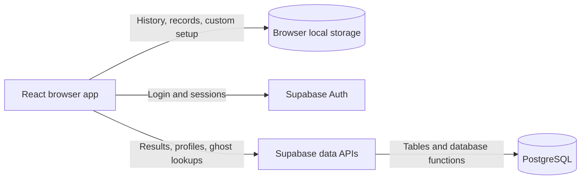

# KEYSMASH

KEYSMASH is a browser typing app for practicing speed and accuracy through timed tests, custom text, and ghost races. Its Neo Brutalist interface supports phones, keyboard controls, and reduced motion.

The app includes:

- Timed tests with 15, 30, 60, and 120-second options.
- Custom practice text up to 2,000 characters, with remembered applied text and timer settings when browser storage is available.
- Results with WPM, accuracy, consistency, raw and net WPM charts, and missed-key bars with exact counts.
- Past-run browsing with mode filters, 20 runs per page, individual run charts, and Previous/Next controls.
- WPM and accuracy trends for the latest 30 standard runs, plus daily averages and personal bests.
- Optional Google and email magic-link login, session restoration, and cloud saving for standard runs.
- Publishable profiles with performance summaries, weekly improvement, and activity charts.
- Ghost races against personal bests or published profile records.
- Chart.js charts and staggered fade-ins that respect reduced-motion preferences.

Guest typing works without an account. Device history retains the latest 50 runs; signed-in users can browse older saved cloud runs. Custom practice results remain local and can be reviewed individually, but are excluded from standard trends, personal bests, public profiles, and ghost races. Account and cloud features require Supabase configuration.

Built with **React**, **JavaScript**, **Vite**, **Chart.js**, **Tailwind CSS**, and **Supabase**.

## Architecture

KEYSMASH is a React single-page application. Typing, timing, scoring, and ghost playback run in the browser. Optional Supabase services provide authentication and cloud data through direct calls from the frontend.

### Browser application

React components present the typing workspace, results, history, and profiles. The typing engine generates repeatable word sets from a seed, calculates scores, and records pace samples. Ghost playback uses the same seeded text with a recorded progress trace or an average-pace fallback. Shared Chart.js components draw run analytics and profile trends, with tables for exact values.

Vite provides the development server and builds the application into static files. Custom CSS and Tailwind CSS support the visual styling and responsive layout.

### Local persistence

Browser local storage holds recent runs, standard personal bests, and the applied custom text and timer. Run history falls back to memory for the current session when storage cannot be written. Custom practice remains on the device and is excluded from standard records and cloud saving.

### Authentication and cloud data

Supabase Auth handles Google and email magic-link login and session restoration. Signed-in users can save completed standard runs to the cloud and manage their profile's handle and publication state.

The frontend accesses PostgreSQL through Supabase table APIs and database functions. Cloud history loads pages of run summaries, fetches detailed samples when a run is selected, and caches visited pages and details. Recent trends load separately so browsing older pages keeps the overview stable.

SQL migrations define the schema, owner access policies, profile summaries, weekly trends, activity data, and ghost lookups. Public profile and ghost functions return only the data needed for those features; raw run analytics remain private to the owner.

### Hosting

The repository has no separate application server. Vercel serves the static frontend, while its configured rewrites let profile, history, login callback, and ghost-race URLs load the application directly. Supabase supplies the optional backend services.
